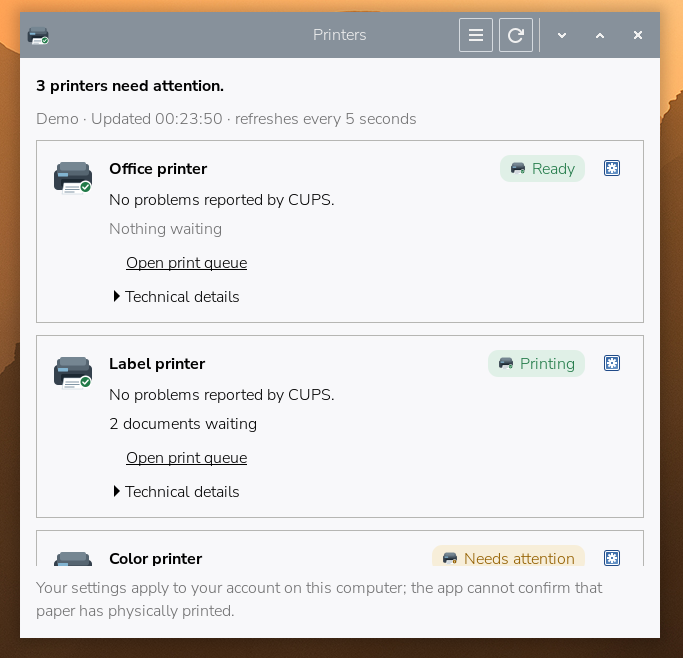

# CUPS Tray Icon

[](https://github.com/M1chlCZ/cups-tray-icon/actions/workflows/ci.yml)
[](LICENSE)

CUPS Tray Icon keeps an eye on the printers connected to your computer. It
lives in the system tray and opens a simple window with one card per printer.
When something needs you, the icon changes, the card says what is wrong and
how to fix it, and a desktop notification can tell you right away.

The app never pauses, cancels or changes jobs, and it never changes the state
of a print queue. The gear button on each card changes only your own printing
defaults, such as the paper size. Anything system-wide stays with the system
printer settings tool.



<!-- Regenerate on a Linux desktop: run `cups_tray_icon.py --demo` and capture the window. -->

*The window in demo mode. Printer names, documents and errors are fictional.*

## What you see

Each printer has a card with its name, a status pill, a sentence in plain
English, how many documents are waiting, a gear button for your own print
settings, a link to the printer's page in CUPS and a **Technical details**
section for the original CUPS messages.

The status pill always shows an icon and a word, so you never have to tell the
states apart by color alone:

| Pill | Meaning | Typical action |
| --- | --- | --- |
| **Ready** (green) | The printer is idle and reports no problems. | Nothing. |
| **Printing** (green) | The printer is working on documents. | Nothing. |
| **Needs attention** (amber or red) | Something is wrong: paper, cover, ink, a document waiting for permission, and so on. | Follow the sentence on the card. |
| **Offline** (red) | A locally attached USB printer was not found on the USB bus. | Check its power and USB cable. |
| **Unknown** (grey) | CUPS did not report a state that the app understands. | Review **Technical details**. |

At the top of the window, a summary line tells you the overall state
("All printers are ready." or "3 printers need attention."), together with the
time of the last check. The window refreshes every five seconds; the refresh
button in the header, **Ctrl+R** and **F5** check immediately.

If no printers are connected to this computer, the window explains that only
printers attached to this computer (and forwarders from your configuration
file) are shown, and offers an **Open printer settings** button. That button
starts the system printer settings when available and falls back to the CUPS
web page.

If the print service cannot be reached, a banner says so, the app keeps
retrying automatically, and the tray icon shows the offline state. Nothing
crashes and nothing is lost.

## Printer settings

Every printer card has a gear button. It opens a **Settings for <name>**
dialog that offers the options this printer actually supports, in plain
language: paper size first, then color, two-sided printing and paper type.

The dialog says **Applies to your account on this computer.** Your choice is
saved as your personal default for that printer: it does not change other
accounts, the printer hardware, printed documents or the state of the queue.
If a printer offers nothing adjustable here, the dialog says so.

**Apply** saves the changed options and refreshes the status list. **Cancel**
closes the dialog without saving. **More options…** opens the system printer
settings tool, which is still the right place for system-wide configuration,
drivers and printer queues.

The app reads the option list only when you open the dialog, so the
five-second status refresh stays fast.

## Notifications

When the app is running, it can send one desktop notification for each of
these events:

- a printer changes into a problem state (something that needs attention),
- a document starts waiting for attention on a printer,
- the print service becomes unreachable, or comes back.

Notifications are sent only when a state actually changes. The usual
five-second refresh never repeats them, and a newer notification for the same
printer replaces the older one instead of stacking. Clicking a notification
opens the printer window.

Notifications are on by default. To turn them off, untick **Problem
notifications** in the header menu, or set `"notifications": false` in the
configuration file. The menu tick and the file are kept in sync.

## Requirements

- Linux with Python 3.10 or newer.
- GTK 3, PyGObject and pycups.
- A local CUPS server with printers already configured.
- A desktop panel that supports **StatusNotifierItem** tray icons.

The interface was checked on Raspberry Pi OS with labwc and wf-panel-pi.
Other panels need to provide the same tray protocol. A GNOME desktop may need
a tray extension. This is a desktop-session app; run it as your normal user.

## Install a Debian package

For Debian 12+, Ubuntu 22.04+ and current Raspberry Pi OS, download the `.deb`
and `SHA256SUMS` from the [latest release](https://github.com/M1chlCZ/cups-tray-icon/releases/latest).
From the download directory:

```sh
sha256sum --check SHA256SUMS
sudo apt update
sudo apt install ./cups-tray-icon_0.1.2_all.deb
cups-tray-icon --show
```

Use the filename from your downloaded release. APT installs the declared Python,
GTK, pycups, SVG and CUPS-daemon dependencies. The same `all` package works on ARM
and x86 systems with those dependencies; desktop tray support is still required.
The package adds an application-menu entry with its icons and a `cups-tray-icon`
command. It does not change printer queues or enable autostart for every user.

To start it automatically for your user:

```sh
mkdir -p "${XDG_CONFIG_HOME:-$HOME/.config}/autostart"
sed 's/ --show$//' /usr/share/applications/cups-tray-icon.desktop > "${XDG_CONFIG_HOME:-$HOME/.config}/autostart/cups-tray-icon.desktop"
```

Upgrade by installing the next release's `.deb` the same way. There is no APT
repository configured for automatic updates. Remove the package with
`sudo apt remove cups-tray-icon`; local config remains untouched. Remove the
autostart entry separately and log out to stop a running instance.

If you previously used `install.py`, uninstall that user copy first so its menu
entry does not shadow the system package. Your printer config is preserved.

## Run from source

On Debian, Ubuntu or Raspberry Pi OS:

```sh
sudo apt install python3-gi gir1.2-gtk-3.0 python3-cups librsvg2-common
git clone https://github.com/M1chlCZ/cups-tray-icon.git
cd cups-tray-icon
/usr/bin/python3 cups_tray_icon.py --show
```

Closing the window or pressing Escape keeps the tray icon running. A second
launch opens the existing instance. **Open CUPS web page** in the header menu
opens the local CUPS web page, and **About** shows the version and license.

## Install for your user

```sh
/usr/bin/python3 install.py --autostart
```

Open **CUPS Tray Icon** from your application menu. On the next login, only the
tray icon starts; the window opens when you click it. Omit `--autostart` if you
prefer manual startup. Run the installer again after updating the checkout.

Files are installed below `~/.local/share/cups-tray-icon`, the application icon
below `~/.local/share/icons/hicolor`, with a desktop menu entry and, when
enabled, `~/.config/autostart/cups-tray-icon.desktop`. `XDG_DATA_HOME` and
`XDG_CONFIG_HOME` are respected. No `sudo` is needed to install the app itself.

To remove it:

```sh
/usr/bin/python3 install.py --uninstall
```

Log out to stop any running instance. Uninstalling preserves your local config
and all CUPS printers and jobs. To disable autostart alone, remove its desktop
entry from your autostart directory.

## Configuration

The optional configuration file is
`~/.config/cups-tray-icon/config.json` (`XDG_CONFIG_HOME` is respected):

| Key | Type | Default | Meaning |
| --- | --- | --- | --- |
| `notifications` | `true` or `false` | `true` | Send desktop notifications when a printer needs attention or the print service changes state. |
| `usb_forwarders` | object | `{}` | Maps CUPS printer names to USB serial numbers for printers that CUPS reaches through a forwarder. |

```json
{
  "notifications": true,
  "usb_forwarders": {
    "Office_Printer": "EXAMPLE_USB_SERIAL"
  }
}
```

No config file is required for ordinary `usb://` printers. A locally attached
USB printer may appear in CUPS as a socket queue when a service such as
`p910nd` forwards data to it; add those queues under `usb_forwarders` so the app
includes them and checks whether the printer is on the USB bus. Only include
printers physically attached to this computer. The app does not create or
configure a forwarder.

Invalid configuration is reported as unavailable status, together with the
check to perform, rather than an empty healthy printer list. Keep your config
local; `config.json` is excluded from Git. Changing **Problem notifications**
in the menu rewrites this file atomically and keeps `usb_forwarders` intact.

## Advanced

- **CUPS web page**: [http://localhost:631](http://localhost:631) lists all
  printers, documents and settings. The header menu opens the printers page,
  and every card links to its printer there.
- **Technical details**: each card can be expanded to show the original CUPS
  message and reason codes, still exactly as CUPS reported them.
- **Demo and diagnostics**:

  ```sh
  /usr/bin/python3 cups_tray_icon.py --demo
  /usr/bin/python3 cups_tray_icon.py --snapshot
  /usr/bin/python3 cups_tray_icon.py --printer-options Office_Printer
  ```

  Demo mode uses fictional data and does not contact CUPS or read local
  config. `--snapshot` reads real status and prints JSON; review printer names
  and CUPS diagnostics before sharing its output. `--printer-options NAME`
  prints the adjustable settings offered for one printer. Combine
  `--demo --snapshot` for sample JSON.

If the window opens but the icon is missing, check that your panel has a
StatusNotifierItem host. Unknown device errors retain the original text under
**Technical details**.

## What status can tell you

CUPS queue status does not prove that a page physically printed. Some drivers
provide limited hardware information, and USB presence alone does not mean a
printer is ready. The app does not independently query ink levels or printer
firmware.

Jobs sent straight to a USB forwarder, bypassing CUPS, cannot be counted here.
The app requests active job states and queue identifiers, not document names,
owners or document contents. It creates no network listener and sends no
telemetry.

## Development

The state, config, notification, printer settings and installer tests use
Python's standard library:

```sh
python3 -B -m unittest discover -s tests -v
```

The GTK smoke check needs the runtime dependencies plus `xvfb` and `dbus-x11`:

```sh
xvfb-run -a dbus-run-session -- /usr/bin/python3 tests/gui_smoke.py
```

CI installs the `.deb` through APT, runs the tests against the package, checks
the window and the exported tray interface, validates the desktop file and
verifies package removal. The smoke check uses demo data and does not need a
printer or a running CUPS server. The packaging test runs when `dpkg-deb` is
available. Issues and focused pull requests are welcome; omit device serials,
private addresses and document data from reports.

## Release packages

Pushing a tag like `v0.1.3` runs the verification workflow, builds
`cups-tray-icon_VERSION_all.deb`, and creates the GitHub release with
`SHA256SUMS` and the package attached. Existing assets are not silently
replaced on a rerun. The package contains no maintainer scripts and stores no
per-user configuration.

To build it on a Debian-based system:

```sh
export SOURCE_DATE_EPOCH="$(git log -1 --format=%ct)"
python3 scripts/build_deb.py 0.1.2
```

The output is in `dist/`. Builds use root ownership in the archive without
requiring root to build. The same source, timestamp and packaging tool versions
produce the same archive.

## License

[MIT](LICENSE). The bundled printer illustrations and state icons are included
under the same license.
